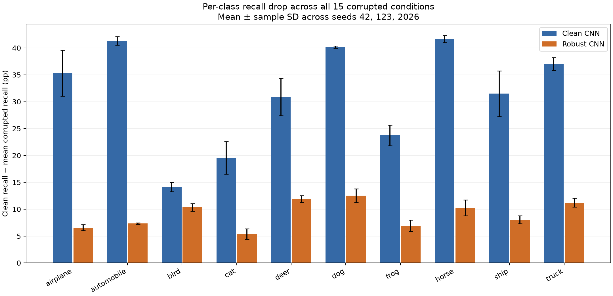
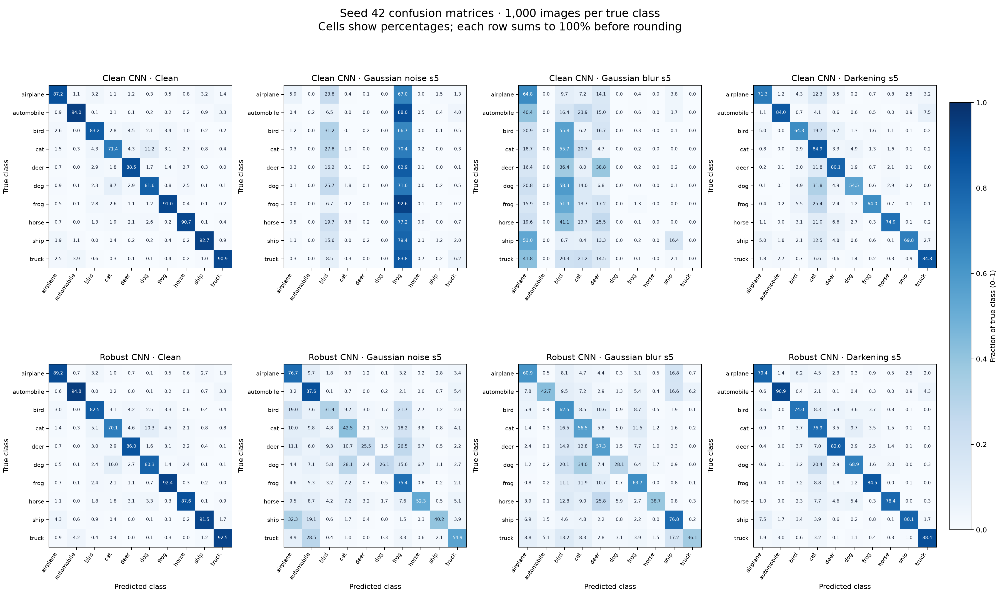

# Per-class analysis of the saved core results

Generated with `python -m scripts.analyze_per_class` from the repository root. This analysis uses the 96 saved confusion matrices; it does not retrain or run inference.

Robust CNN improves mean corrupted recall in **30/30 class–seed pairs**. The largest average gain is automobile (+34.15 pp), followed by horse (+30.49 pp). Bird gains least (+2.73 pp). Individual severe conditions still contain class-level regressions.

## Recall across all three seeds

Recall is diagonal count / true-class support. The mean corrupted recall averages all 15 conditions within each seed first. Drops are clean minus corrupted recall; paired changes are Robust minus Clean within the same seed. All ± values are sample SD (ddof=1) across seeds 42, 123, 2026, not confidence intervals.

| Class | Clean recall % (Clean / Robust) | Corrupted recall % (Clean / Robust) | Clean drop pp | Robust drop pp | Paired corrupted gain pp |
| --- | --- | --- | --- | --- | --- |
| airplane | 88.47 / 89.27 | 53.14 / 82.69 | 35.32 ± 4.28 | 6.58 ± 0.56 | +29.55 ± 3.45 |
| automobile | 94.17 / 94.30 | 52.82 / 86.97 | 41.35 ± 0.79 | 7.33 ± 0.12 | +34.15 ± 1.60 |
| bird | 82.47 / 81.40 | 68.34 / 71.07 | 14.13 ± 0.89 | 10.33 ± 0.73 | +2.73 ± 1.22 |
| cat | 74.00 / 71.77 | 54.43 / 66.39 | 19.57 ± 3.04 | 5.38 ± 0.98 | +11.96 ± 4.19 |
| deer | 87.00 / 85.63 | 56.11 / 73.75 | 30.89 ± 3.49 | 11.89 ± 0.63 | +17.64 ± 4.00 |
| dog | 80.97 / 79.10 | 40.80 / 66.57 | 40.17 ± 0.20 | 12.53 ± 1.27 | +25.77 ± 0.78 |
| frog | 90.80 / 91.57 | 67.07 / 84.63 | 23.73 ± 1.93 | 6.94 ± 1.07 | +17.56 ± 2.32 |
| horse | 88.87 / 87.93 | 47.19 / 77.68 | 41.67 ± 0.66 | 10.25 ± 1.48 | +30.49 ± 1.91 |
| ship | 93.07 / 92.53 | 61.58 / 84.51 | 31.49 ± 4.24 | 8.02 ± 0.73 | +22.93 ± 4.22 |
| truck | 91.93 / 92.50 | 54.92 / 81.27 | 37.01 ± 1.18 | 11.23 ± 0.83 | +26.35 ± 0.96 |

**Figure 07.** Each bar is the seed mean of clean recall minus mean recall over 15 equally weighted corrupted conditions. Error bars show sample SD over three seeds. Class order follows the saved dataset manifest. [PDF](figures/per_class_drop.pdf); [per-seed source](tables/per_class_run_summary.csv).

All 960 class/condition/seed rows, including clean references and recall drops, are in [per_class.csv](tables/per_class.csv). [Family summaries](tables/family_class_summary.csv) average the five severities within each seed; [paired class changes](tables/per_class_paired_deltas.csv) retain all three seeds. [Class-by-condition means and SDs](tables/class_condition_summary.csv) retain severity-specific effects.

A small recall drop does not imply high recall: Robust cat recall starts lower on clean images and remains among its lowest corrupted recalls. Likewise, high recall for a class attracting many false positives can mask poor discrimination; the off-diagonal counts below expose that behavior.

## Common misclassifications

The following are the three largest directed off-diagonal cells for each model and displayed condition, ranked by their mean count across all three seeds. Counts are out of 1,000 true-class images in each seed; they are not percentages of errors. Ties use ascending true-class ID, then predicted-class ID.

| Model | Condition | True → predicted | 42 | 123 | 2026 | Mean count |
| --- | --- | --- | --- | --- | --- | --- |
| Clean CNN | Clean s0 | cat → dog | 112 | 110 | 111 | 111.00 |
| Clean CNN | Clean s0 | dog → cat | 87 | 93 | 113 | 97.67 |
| Clean CNN | Clean s0 | bird → deer | 45 | 42 | 33 | 40.00 |
| Clean CNN | Gaussian noise s5 | automobile → frog | 880 | 648 | 835 | 787.67 |
| Clean CNN | Gaussian noise s5 | deer → frog | 829 | 470 | 902 | 733.67 |
| Clean CNN | Gaussian noise s5 | truck → frog | 838 | 523 | 791 | 717.33 |
| Clean CNN | Gaussian blur s5 | dog → bird | 583 | 439 | 854 | 625.33 |
| Clean CNN | Gaussian blur s5 | cat → bird | 557 | 339 | 798 | 564.67 |
| Clean CNN | Gaussian blur s5 | frog → bird | 519 | 367 | 788 | 558.00 |
| Clean CNN | Darkening s5 | dog → cat | 318 | 359 | 453 | 376.67 |
| Clean CNN | Darkening s5 | frog → cat | 254 | 289 | 321 | 288.00 |
| Clean CNN | Darkening s5 | bird → cat | 197 | 254 | 268 | 239.67 |
| Robust CNN | Clean s0 | dog → cat | 100 | 111 | 108 | 106.33 |
| Robust CNN | Clean s0 | cat → dog | 103 | 99 | 104 | 102.00 |
| Robust CNN | Clean s0 | cat → bird | 51 | 49 | 39 | 46.33 |
| Robust CNN | Gaussian noise s5 | ship → airplane | 323 | 341 | 416 | 360.00 |
| Robust CNN | Gaussian noise s5 | dog → cat | 281 | 207 | 305 | 264.33 |
| Robust CNN | Gaussian noise s5 | truck → automobile | 285 | 202 | 278 | 255.00 |
| Robust CNN | Gaussian blur s5 | dog → cat | 340 | 388 | 436 | 388.00 |
| Robust CNN | Gaussian blur s5 | truck → ship | 172 | 288 | 258 | 239.33 |
| Robust CNN | Gaussian blur s5 | automobile → ship | 166 | 255 | 241 | 220.67 |
| Robust CNN | Darkening s5 | dog → cat | 204 | 212 | 246 | 220.67 |
| Robust CNN | Darkening s5 | frog → cat | 88 | 99 | 116 | 101.00 |
| Robust CNN | Darkening s5 | bird → cat | 83 | 109 | 102 | 98.00 |

Clean-image errors prominently confuse cats and dogs in both models. At noise s5, Clean CNN sends many other classes to frog; at blur s5, many errors go to bird. These directions recur across all three seeds, although their counts vary substantially. Robust CNN reduces these dominant patterns but retains substantial errors, including ship → airplane under noise and dog → cat under blur and darkening. This describes observed predictions; it does not identify a causal feature mechanism.

For every true class, model, seed, and condition, [common_misclassifications.csv](tables/common_misclassifications.csv) retains the top three destinations (ties by predicted-class ID). [All 9,600 cells](tables/confusion_counts.csv) preserve the full matrices. [Corrupted confusion summaries](tables/corrupted_confusion_summary.csv) average 15 conditions within each seed, then report mean and sample SD over seeds.

## Seed-42 confusion matrices

**Figure 08.** The preselected seed 42, with Clean CNN on the top row and Robust CNN below; columns are clean, Gaussian noise s5, Gaussian blur s5, and darkening s5. Rows are true labels and columns predicted labels. All panels share the 0–1 color scale; annotations are percentages. Every row has 1,000 images and every panel has 10,000. [PDF](figures/confusion_seed42.pdf).

## Paired overall comparison

| Seed | Clean accuracy change pp | mCA change pp |
| --- | --- | --- |
| 42 | -0.43 | +21.46 |
| 123 | -1.08 | +21.24 |
| 2026 | -0.21 | +23.04 |

Mean paired clean change: **-0.57 ± 0.45 pp**. Mean paired mCA change: **+21.91 ± 0.98 pp**.

## Severity-specific exceptions and RQ evidence

All severity-5 class regressions in the three-seed mean are shown below. The per-seed signs demonstrate why seed 42 alone is insufficient for inference.

| Condition | Class | Clean recall % | Robust recall % | Δ42 pp | Δ123 pp | Δ2026 pp | Mean Δ pp |
| --- | --- | --- | --- | --- | --- | --- | --- |
| Darkening s5 | cat | 87.57 | 79.87 | -8.00 | -6.30 | -8.80 | -7.70 |
| Gaussian blur s5 | bird | 66.17 | 56.13 | +6.70 | +2.70 | -39.50 | -10.03 |
| Gaussian noise s5 | bird | 37.07 | 32.13 | +0.20 | -33.00 | +18.00 | -4.93 |
| Gaussian noise s5 | frog | 85.23 | 69.90 | -17.20 | +3.70 | -32.50 | -15.33 |

| Model | Family | s1 % | s2 % | s3 % | s4 % | s5 % |
| --- | --- | --- | --- | --- | --- | --- |
| Clean CNN | Gaussian noise | 82.60 | 54.48 | 29.97 | 17.99 | 13.83 |
| Clean CNN | Gaussian blur | 87.23 | 63.82 | 29.92 | 22.13 | 19.32 |
| Clean CNN | Darkening | 87.21 | 86.78 | 85.75 | 82.31 | 71.24 |
| Robust CNN | Gaussian noise | 86.01 | 83.63 | 79.28 | 70.10 | 50.86 |
| Robust CNN | Gaussian blur | 86.59 | 83.70 | 78.36 | 68.69 | 51.46 |
| Robust CNN | Darkening | 86.49 | 86.41 | 86.06 | 84.77 | 80.90 |

- **RQ1:** Clean CNN accuracy falls sharply with noise and blur severity; darkening is less damaging on these specified scales. Its very mild blur and darkening means are slightly above clean accuracy; these measured departures are retained rather than smoothed away.
- **RQ2:** Recall drops vary widely by class. Figure 07 and the full class tables quantify them; Figure 08 and directed error counts show the recurring frog, bird, and cat prediction concentrations under severe corruptions.
- **RQ3:** Every seed has positive overall mCA improvement, and every class–seed pair has positive mean corrupted recall improvement. This does not imply improvement in every class/condition; the exception table shows the severity-5 reversals.
- **RQ4:** Every seed has lower overall clean accuracy with Robust CNN. The mean loss and its paired SD are reported above, alongside the much larger mCA gain. Individual clean class recalls can improve or decline.

## Verification and provenance

All 96 matrices pass the existing core-matrix validator and an additional comparison of every row sum against `report/data003_evidence.json`, `observations.full_loaders.test.class_counts`: 1,000 for each of the ten classes. Each matrix totals 10,000 and its trace matches saved `n_correct`; reconstructed recalls, accuracy and macro-F1 match the saved results. Class names agree with `data/splits/split_manifest.json`. All six existing aggregate summaries (run, model, condition, paired deltas, paired summary, per-class) are rebuilt and compared numerically to their saved CSVs.

[verification.json](verification.json) records input and output hashes, runtime versions, dimensions, checkpoint identities and prediction-file availability. [Per-condition checks](tables/count_verification.csv) expose the numeric audit. The six [selected checkpoints](../../../outputs/checkpoints/core-v1/README.md) are hashed and compared to the result rows. The original prediction NPZ files are absent from this checkout, so this run verifies saved counts, not logits, per-image labels, or individual failure IDs. The earlier logits check is recorded in [reproduction.md](../../reproduction.md).

Conclusions describe training variability on one fixed split/test set, one architecture and three specified corruption families. Severity scales are not perceptually matched. Severities 4–5 extend training intensities 1–3 within known families; these results do not establish robustness to unseen corruption families. Repeated views and seeds are not independent samples of new test populations. Independent human review, fresh-machine replay, and formal pre-test sign-off remain open; this automated count check does not satisfy them.
